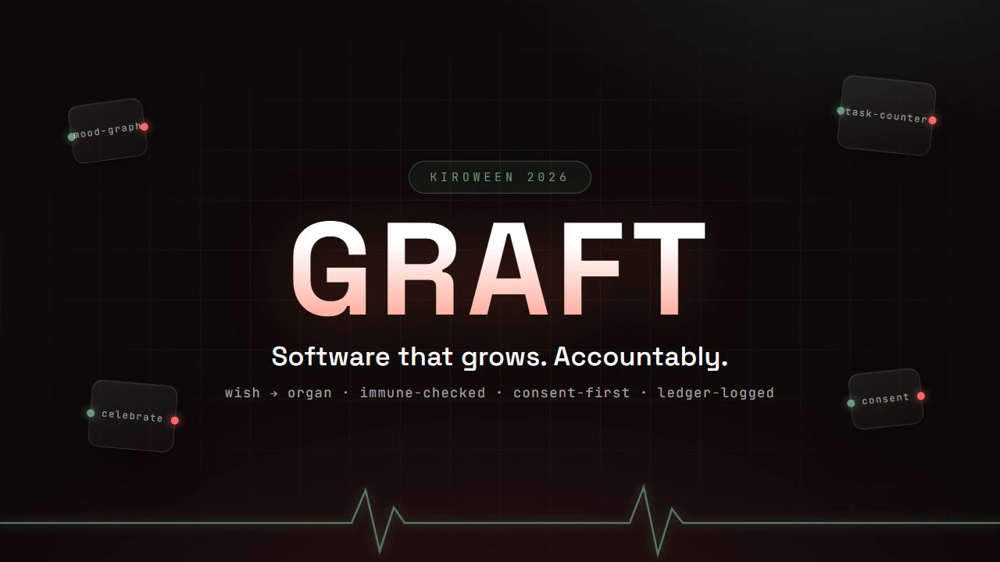
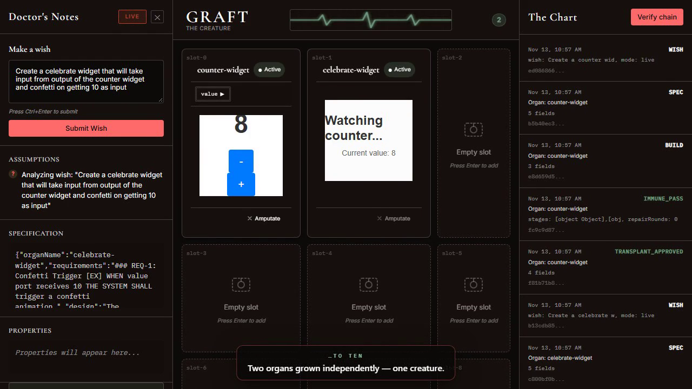
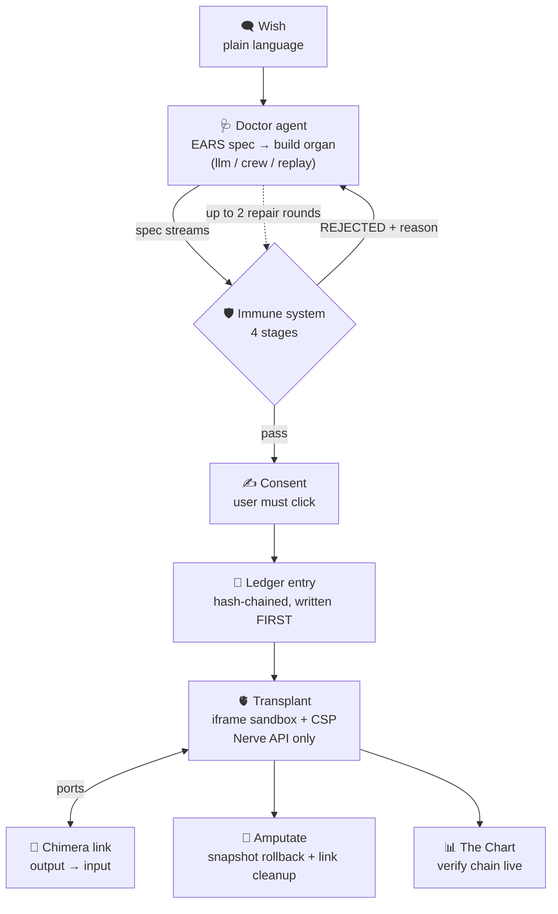
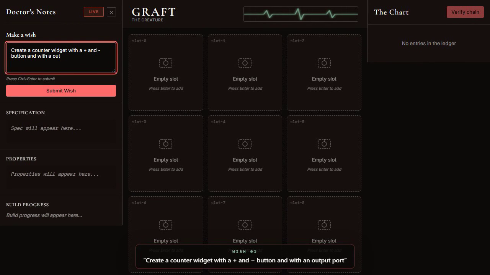
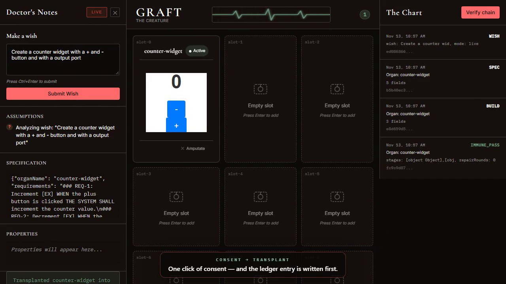
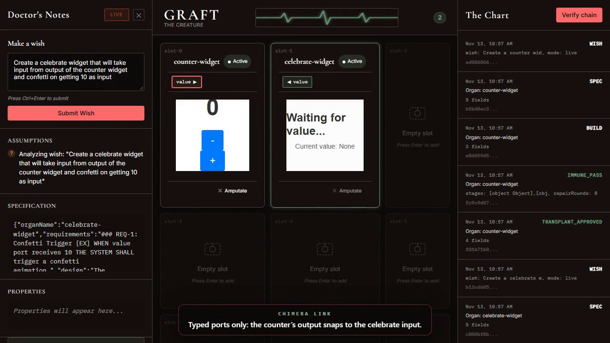
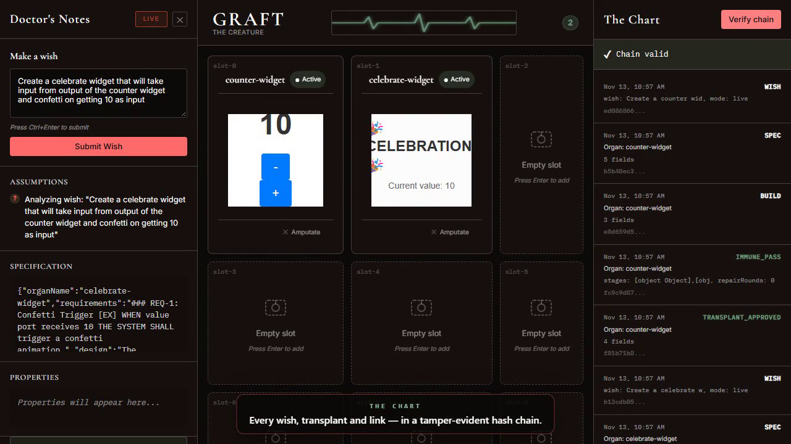
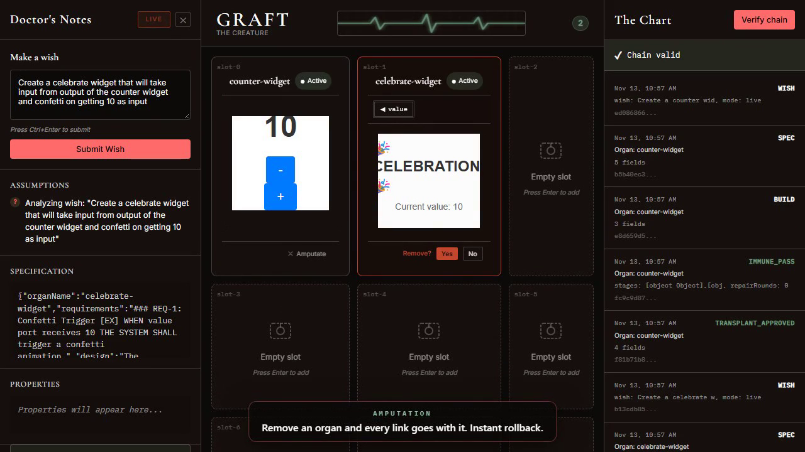
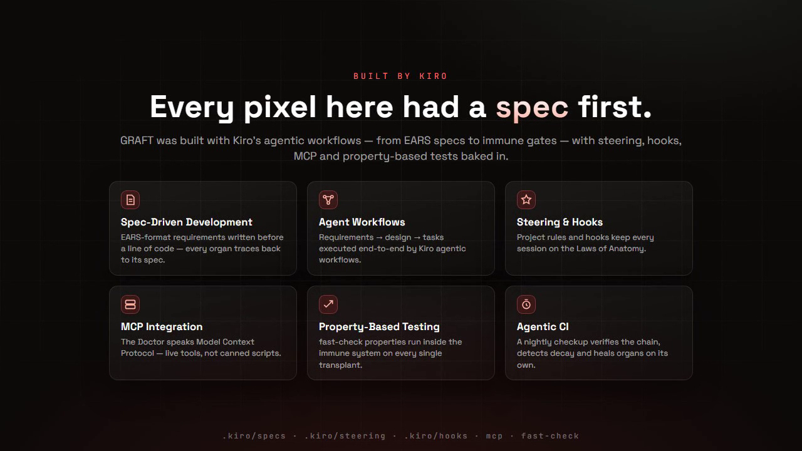

# GRAFT: Software that grows. Accountably.

<p align="center">
  
</p>

<p align="center">
  <a href="#-demo-video"></a>
  <a href="https://github.com/roshanrateria/GRAFT"></a>
  
  
  <a href="LICENSE"></a>
  = 22" />
  
</p>

GRAFT is a small living application called **the Creature** that grows new features on demand. The user makes a wish in plain language. A Doctor agent writes a spec and builds the feature as an **organ**. An **immune system** checks the organ, and a rejected organ comes back with a specific reason. A passing organ waits for the user's consent, then runs live inside a sandboxed iframe. Every organ keeps its provenance in a hash-chain ledger and can be amputated.

Hackathon category: Frankenstein. Also submitted for Best Kiro Crew App.

GRAFT reduces risk. It does not guarantee safety. See [THREAT_MODEL](#threat_model).

## 🎬 Demo video

**▶ [Watch the 1:47 demo](https://youtu.be/oqbuqR6nlxw)** — recorded live from the running app: two wishes asked verbatim, both transplanted through the immune system, chimera-linked, celebrated at 10, verified in the ledger, and amputated. Narrated, no copyrighted music, storyboard + timestamps in [DEMO_GUIDE.md](DEMO_GUIDE.md).

| Wish 1 (verbatim) | Wish 2 (verbatim) |
|---|---|
| *"Create a counter widget with a + and - button and with a output port"* | *"Create a celebrate widget that will take input from output of the counter widget and confetti on getting 10 as input"* |

Both were grown **live** through the full pipeline in the video (Gemini via the `llm` provider, passcode unlocked).

<p align="center">
  
</p>

## How It Works



1. **Wish**: the user describes a feature in plain language.
2. **Doctor**: an AI provider (`llm`, `crew` or `replay`) writes a spec and builds an organ.
3. **Immune system**: four stages (static, manifest, behavioral, property) check the organ. The Doctor gets up to 2 repair rounds.
4. **Consent**: the user must click to approve a transplant.
5. **Transplant**: the organ runs in `<iframe sandbox="allow-scripts">` with a strict CSP. The ledger entry is written before the state change.
6. **Provenance**: the Chart (ledger) records wishes, specs, immune results, transplants and amputations.
7. **Reversibility**: amputation removes an organ, its chimera links and restores the prior state.

Glossary: Creature (host app), Organ (generated feature), Nerve API (the only channel between an organ and the Creature), Chimera (organs linked by ports), Chart (ledger).

## 📸 The beats

<p align="center">
  
  
</p>
<p align="center">
  
  
</p>
<p align="center">
  
  
</p>

## Status

Honest summary of what works and what does not. Details are in [docs/STATUS.md](docs/STATUS.md).

| Area | State |
|------|-------|
| Creature, Nerve API, sandbox host | Implemented |
| Immune system (4 stages, U1 to U7, hostile suite) | Implemented |
| Doctor pipeline (llm, crew, replay providers, repair loop, SSE, consent) | Implemented. The `crew` provider is a REST client that was not exercised live here. |
| Ledger, snapshots, amputation | Implemented, with property tests (LED-01, REV-01, REV-02) |
| Chimeras (keyboard linking, cycle prevention, cleanup on amputation) | Implemented, but 3 tests currently fail (see Known Limitations) |
| Checkups | Scripts exist (`pnpm checkup`, `pnpm checkup:dry`). No UI. |
| Healing and decay simulator | Partial. `heal()` exists in the Doctor providers. The UI for approving a healing patch and the decay simulator are not implemented. |
| Demo mode controls (spec 08) | Not implemented in the UI |

## Benchmark Results

Source files: `fixtures/corpus/results.json`, `fixtures/corpus/ablation.json`, `fixtures/corpus/results-held-out-v2.json`. Method and caveats are in [fixtures/corpus/SUMMARY.md](fixtures/corpus/SUMMARY.md).

The corpus has 96 organs: 70 development, 20 held-out and the 6 hostile reference organs. The benchmark counts 76 attacks (60 development, 16 held-out).

| Source | Attacks | Caught | Missed | Catch rate |
|--------|---------|--------|--------|------------|
| Development | 60 | 46 | 14 | 76.7% |
| Held-out | 16 | 10 | 6 | 62.5% |
| Total | 76 | 56 | 20 | 73.7% |

The held-out set was frozen at commit `a3080bab5c4c22f4b7907cb10e4d6cf15dffd1a9` (2026-11-10). A second held-out set (held-out-v2, 24 attacks, 6 benign) caught 19 of 24 (79.2%) in `results-held-out-v2.json`.

Catch rate by stage (cumulative, 76 attacks): static 51, manifest 56, behavioral 56, property 56. The behavioral and property stages added no catches on this corpus.

| Category | Caught | Total |
|----------|--------|-------|
| Obfuscated | 18 | 19 |
| Direct | 27 | 31 |
| Sandbox escape | 6 | 13 |
| Behavioral | 5 | 13 |

Ablation (`fixtures/corpus/ablation.json`): a sandbox+CSP-only baseline caught 36 of 76 (47.4%) and the full immune system caught 56 of 76 (73.7%). The baseline is modeled by `scripts/ablation-study.ts`, not measured in a real browser.

**False rejections.** Every benign organ in the corpus (14 of 14: 10 development, 4 held-out) was rejected by static analysis because it uses `window.parent`. This is a real weakness: the benign corpus organs post to the parent directly instead of using the Nerve shim, and the checker bans that. In `results.json` the 6 hostile reference organs are also labeled benign, so its own "20 false rejections" figure is inflated. The 6 hostile organs are all rejected as intended (`packages/immune/src/__tests__/hostile.test.ts`).

## Quick Start

```bash
pnpm install
pnpm build      # builds nerve, server and web (web dist is served by the server)
pnpm dev        # web on http://localhost:3000, API on http://localhost:3001
pnpm test       # vitest, see Known Limitations for the current result
```

No API key needed to try it: without a live session the Doctor streams canned replay output (`_replay: true` on every event). For the live LLM path, see [Environment variables](#environment-variables).

## Run Instructions

### Prerequisites

- Node.js 22 or newer (`engines.node` is `>=22.0.0`; the repo was last run here on Node 24)
- pnpm 9.12.3 (`packageManager` field)

### Development

```bash
pnpm install
cp apps/server/.env.example apps/server/.env   # then edit; never commit .env
pnpm dev
```

`pnpm dev` runs every workspace `dev` script in parallel. The Vite dev server listens on port 3000 and proxies `/api` to the Fastify server on port 3001 (`apps/web/vite.config.ts`, `apps/server/src/index.ts`).

Without a live session the wish endpoint streams canned responses chosen by keyword (`apps/server/src/benchmarkWishes.ts`). These events carry `_replay: true`. That is the default path and needs no API key. See "Replay vs live" below.

### Build

```bash
pnpm build
pnpm start      # serves the built web app + API from one Fastify process
```

This builds `@graft/nerve`, `@graft/server` and `@graft/web`. When `apps/web/dist` exists, the server serves it at `/` (`apps/server/src/index.ts`). The server `start` script is `node dist/apps/server/src/index.js` (tsc emits a nested path because the workspace path mapping pulls `@graft/nerve` sources into the compilation).

### Environment variables

Names come from `apps/server/.env.example`. Put values in `apps/server/.env`, which is ignored by git. Never commit real keys.

| Variable | Purpose | Default in code |
|----------|---------|-----------------|
| `DOCTOR_PROVIDER` | `crew`, `llm` or `replay` for live wishes | `llm` (a value of `replay` disables live wishes) |
| `LLM_BASE_URL` | LLM API base URL for the `llm` provider | `https://integrate.api.nvidia.com/v1` (`packages/doctor/src/providers/llm.ts`) |
| `LLM_API_KEY` | LLM API key for the `llm` provider | none |
| `DOCTOR_MODEL` | Model identifier | `nvidia/nemotron-3.5-bolt-e4b` (`packages/doctor/src/providers/llm.ts`) |
| `LIVE_PASSCODE` | Passcode that unlocks live Doctor mode | `test` if unset (see warning) |
| `PORT` | Server port | `3001` |
| `HOST` | Server host | `localhost` |
| `CORS_ORIGIN` | Allowed origin for the frontend | `http://localhost:3000` |
| `LOG_LEVEL` | `trace`, `debug`, `info`, `warn` or `error` | `info` |

**Warning: `LIVE_PASSCODE` falls back to `test`.** In `apps/server/src/index.ts` the code is `process.env.LIVE_PASSCODE || 'test'`, so live mode is always available and guessable unless you set this variable. Live mode spends LLM credits. Set a strong passcode before any public deployment. The server caps live wishes at 10 per hour per session and 50 per day overall (`RATE_LIMIT_MAX_PER_HOUR`, `RATE_LIMIT_MAX_PER_DAY` in the same file; the exact hourly keying was not re-checked).

### Replay vs live

- **Replay (default).** No passcode, no network. The server streams canned output and marks each event `_replay: true`. Any wish text is mapped to one of four built-in wishes, with a task counter as the fallback. Known gap: the web UI does not currently show a "REPLAY" badge. It only shows a "LIVE" badge after passcode login. When presenting replay output, say so out loud or in a caption.
- **Live.** Enter the passcode in Doctor's Notes. The wish goes to the configured provider (`llm` by default) and needs `LLM_API_KEY`.

## Immune CLI

```bash
pnpm immune ../../organs/hostile/01-direct-fetch
```

The CLI runs inside `packages/immune-cli`, so relative paths resolve from there. Use `../../` or an absolute path. Options: `--json`, `--verbose`, `--stage <manifest|static|behavioral|property>`.

Exit codes: 0 approved, 1 rejected, 2 error (bad input, missing files).

Verified output for the hostile fetch organ:

```
VERDICT: REJECTED
  Reason: fetch() is not allowed
  Stage: static
  Code: IMM_BANNED_FETCH
```

Not every organ in `organs/handwritten/` passes. `expense-tracker`, `mood-weather`, `quick-note` and `timer-widget` are rejected for `window.parent`. The other seven have no `manifest.json`, so the CLI exits with an error. The `quick-note` defect is deliberate.

The GitHub Action `.github/workflows/immune-check.yml` runs the CLI on changed `organs/**` in pull requests. It is the only CI workflow. It does not run the test suite.

## Tests

| Command | What it runs |
|---------|--------------|
| `pnpm test` | Root `vitest run` over `**/*.test.ts` |
| `cd apps/web && npx vitest run` | Web suite in jsdom, including `*.test.tsx` |
| `pnpm test:immune` | Tests in `packages/immune` |
| `pnpm test:a11y` | Runs `vitest run --filter @graft/web --reporter=verbose` from the root. Not verified to select only the web tests. |
| `pnpm exec playwright test` | e2e specs in `tests/e2e` (starts the stack with `scripts/dev-e2e.mjs`). Not run for this README. |
| `pnpm preflight` | `scripts/preflight.sh` |
| `pnpm benchmark`, `pnpm benchmark:corpus` | Immune benchmarks |
| `pnpm checkup`, `pnpm checkup:dry`, `pnpm checkup:schedule` | Nightly re-verification scripts |

Property-based tests (fast-check) live next to the code they test:
`packages/ledger/src/__tests__/led-01-property.test.ts`, `apps/web/src/__tests__/rev-01-property.test.ts`, `apps/web/src/__tests__/rev-02-property.test.ts`, `packages/immune/src/__tests__/universal-properties.test.ts` (U1 to U7), and the schema tests in `packages/nerve/src/__tests__/`. The `tests/properties/` folder named in the steering docs is empty and not tracked by git. Host-level properties H2 (acyclicity) and H5 (quarantine) have no dedicated property suite.

## Known Limitations

- **3 failing tests.** `pnpm test` last gave 3 failed, 458 passed, 1 skipped (23 files). All three are in `apps/web/src/__tests__/chimera-linking.test.ts` and exercise `apps/web/src/ChimeraLinking.ts`:
  - `schemasCompatible (CHI-01) > primitive roots: integer feeds integer and number, but not string or the reverse`: `number` is accepted where `integer` is required.
  - `schemasCompatible (CHI-01) > a multi-field object cannot feed a primitive input`: a two-field object is accepted by a primitive input.
  - `schemasCompatible (CHI-01) > tolerates an organ whose manifest has no ports array`: `getCompatibleTargets` throws `TypeError: organ.manifest.ports is not iterable`.
  These are not fixed. The tests define the intended contract.
- **Root vitest skips `*.test.tsx`.** `vitest.config.ts` includes `*.test.ts` only. The component and accessibility tests run via `apps/web` (168 tests, 3 failing).
- **No axe-core.** It is not a dependency. Accessibility tests check contrast and keyboard behavior with custom code. This is not a full WCAG validation, which needs manual testing with assistive technology.
- **Healing and decay UI, and demo mode controls, are not implemented.** Hostile injection, fast-forward and reset buttons from spec 08 do not exist.
- **L9 gaps.** The ledger panel falls back to mock entries when the server is down, with no label. The replay path has no UI badge.
- **Benchmark.** Behavioral and sandbox-escape categories catch under half of attacks. All benign corpus organs are rejected (see above).
- **Wish trial.** See [docs/wish-trial-results.md](docs/wish-trial-results.md): 9 of 10 wishes passed the full pipeline in one recorded run.

## Architecture

```
Creature (apps/web)
  Slot grid (organs in sandboxed iframes) <-> NerveHost (validation, rate limit, quarantine)
  Doctor's Notes | Chart (ledger) | Laboratory overlay | Consent dialog

Server (apps/server, Fastify + SQLite)
  /api/doctor/*   wish SSE, live auth, status
  /api/ledger/*   history, verify, append (hash chain)

packages/
  nerve        schemas, protocol constants, tissue kit
  immune       static, manifest, behavioral, property stages
  immune-cli   command line wrapper
  doctor       llm, crew, replay providers and repair loop
  ledger       canonical JSON and hash-chain verification
```

## Project Structure

```
.kiro/           specs, steering, hooks, agents, MCP settings
apps/web         Vite + React + Zustand
apps/server      Fastify + better-sqlite3
packages/        nerve, immune, immune-cli, doctor, ledger
organs/          handwritten reference organs and 6 hostile organs
fixtures/        replays and benchmark corpora
tests/e2e        Playwright specs
scripts/         benchmarks, demos, checkups, preflight
docs/            NERVE_API, LAWS_OF_ANATOMY, STATUS, trial results, journal
```

## Documentation

- [Nerve API](docs/NERVE_API.md)
- [Laws of Anatomy](docs/LAWS_OF_ANATOMY.md)
- [Implementation status](docs/STATUS.md)
- [Demo guide](DEMO_GUIDE.md)
- [Spec vs vibe results](docs/spec-vs-vibe-results.md)
- [Wish trial results](docs/wish-trial-results.md)
- [Corpus summary](fixtures/corpus/SUMMARY.md)
- [Kiro usage journal](KIRO_USAGE.md)
- [Original build brief](project-brief.md)

## THREAT_MODEL

**GRAFT reduces risk. It does not guarantee safety.**

### What GRAFT defends against (partially)

- **Network requests from organs**: the CSP (`default-src 'none'`) and the iframe sandbox block them at runtime. Static analysis rejects `fetch` and similar calls before install.
- **Cookie, storage and parent access**: the sandbox has no `allow-same-origin`. Static analysis rejects the common patterns.
- **Message flooding**: the NerveHost allows 20 messages per second per organ and quarantines violators. Payloads over 16 KB are dropped.
- **Undeclared ports and permissions**: manifest validation cross-checks declarations against the code.
- **Silent installs**: nothing installs without a user click, and every state change is written to the ledger first.

### What GRAFT does NOT defend against

- **Browser zero-days**: an exploit in the browser can escape the sandbox.
- **Host compromise**: malicious code in the Creature or the server bypasses every check.
- **Social engineering**: a user can approve a harmful organ.
- **Resource exhaustion beyond the rate limits**: CPU or memory bombs can freeze the tab before quarantine.
- **Side-channel attacks**: timing and speculative execution.
- **Physical access** to the user's device.
- **Leaked or weak credentials**: a default `LIVE_PASSCODE` of `test` and any API key in a local `.env` are the operator's responsibility.

### Known gaps from the benchmark

The immune system missed 20 of 76 attacks (26.3%) in the corpus. Misses by category: behavioral 8, sandbox escape 7, direct 4, obfuscated 1 (from `results.json`). Bare `top`, `parent` and `opener` identifiers, some `EventSource` and `exec` patterns, and attacks that use only allowed operations were not caught. The corpus was written by a red-team agent and is not a measure of real-world attackers. If you find a bypass, please report it responsibly.

### Security boundaries

1. **Iframe sandbox plus CSP** is the real security boundary.
2. **Immune system** is defense in depth.
3. **Ledger** is tamper-evident (hash chain), not digitally signed.
4. **Replay output** is meant to be labeled as replay. See the L9 gaps above.

## Kiro Usage

Full journal: [KIRO_USAGE.md](KIRO_USAGE.md) and `docs/journal/`.

- **Specs**: eight specs in `.kiro/specs/` (requirements and design for all, `tasks.md` for 01 to 07; spec 08 has none).
- **Steering**: seven files in `.kiro/steering/` (product, tech, structure, laws of anatomy, PBT, theatre design, journal).
- **Hooks**: five in `.kiro/hooks/` (immune tests on change, accessibility tests on UI change, Nerve docs sync, preflight, PBT gap check).
- **Custom agents**: `.kiro/agents/graft-doctor.md` and `.kiro/agents/red-team.md`. The red-team agent generated the benchmark corpus under a clean-room rule.
- **Property-based testing**: fast-check, with files listed under Tests.
- **MCP**: `.kiro/settings/mcp.json` configures the `context7` (`@upstash/context7-mcp`) and `playwright` (`@executeautomation/playwright-mcp-server`) servers; both package names are published on npm. The config ships with empty `env` blocks and no keys.
- **Crew**: the `crew` provider and `.kiro/scheduling/checkup-schedule.md`. PLACEHOLDER: describe how the Crew bot differed from IDE and CLI once confirmed by the author.
- **Spec vs vibe**: [docs/spec-vs-vibe-results.md](docs/spec-vs-vibe-results.md), a small self-reported experiment.

## License

MIT. See [LICENSE](LICENSE).

## Acknowledgments

Built for **Kiroween 2026** (the Kiro hackathon) by [Roshan Rateria](https://github.com/roshanrateria).

- 🎬 Demo video: <https://youtu.be/oqbuqR6nlxw>
- 📦 Repository: <https://github.com/roshanrateria/GRAFT>
- 📝 Kiro usage write-up: [KIRO_USAGE.md](KIRO_USAGE.md)

---

Software that grows. Accountably. (Not guaranteed safe.)
